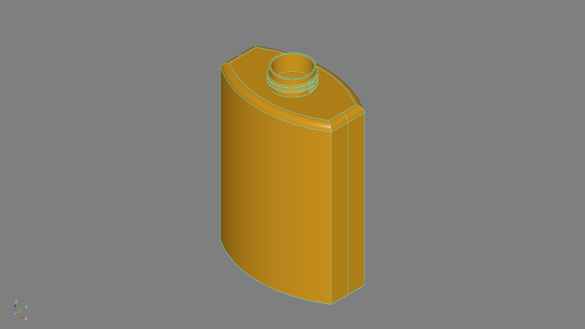

= DSL for CAD Bodies and Assemblies
:icons: font

The purpose of this tool is to share 3D parts and assemblies like java class binaries.

As of today, the DSL is not complete to define bodies, and assemblies place parts face against face, without solver.

.The OCCT bottle tutorial, written with the DSL (`BottleTest`)

== Modules

* `cad-dsl`: the DSL, in pure Groovy. Models only need it to compile, and it builds without OCCT.
* `cad-dsl-occt`: the Open CASCADE kernel running the DSL (`CadDslVisitor`), with the jextract bindings and the low-level `binding` and `builder` code.
* `cad-dsl-native`: the C API over OCCT, loaded by `cad-dsl-occt`.

The DSL finds its kernel at runtime with `ServiceLoader` (`org.taack.cad.dsl.kernel.CadKernel`), so `cd()` works as soon as
`cad-dsl-occt` is on the classpath and `cad-dsl-native` in `java.library.path` (see <<Native Library>>).

== Scripts

`cad-dsl` runs a model written as a Groovy script, without any project or test around it:

[bash]
----
./gradlew :cad-dsl-occt:installDist   # or distZip, to share it
cad-dsl-occt/build/install/cad-dsl/bin/cad-dsl samples/pillow-block.groovy             # <1>
cad-dsl-occt/build/install/cad-dsl/bin/cad-dsl samples/pillow-block.groovy block.step  # <2>
----

<1> Opens the shape in the viewer.
<2> The arguments following the script are available as `args`; this sample exports to the file given.

`cad-dsl` passes `CAD_DSL_OPTS` and `JAVA_OPTS` to the JVM: set `java.library.path` there (see <<Native Library>>).

[bash]
----
export CAD_DSL_OPTS="-Djava.library.path=$PWD/cad-dsl-native/build/lib/main/release"
----

From Gradle, `./gradlew :cad-dsl-occt:run --args="$PWD/samples/pillow-block.groovy"` sets it to the library just built.

The DSL packages (`org.taack.cad.dsl`, `.geom`, `.helper`), `CadDsl.cd()` and `java.lang.Math` are imported for the script:

.sphere.groovy
[source,groovy]
----
cd().position(new Vec(0, 0, 1)) {
    sphere(sqrt(4))
}.display(args ? args[0] : null)
----

To get code completion, write the imports anyway (see `samples/pillow-block.groovy`) and open the scripts
in a project depending on `org.taack.cad:cad-dsl` only.

== Building

`./gradlew cad-dsl:build` only needs a JDK. The native part requires https://github.com/Open-Cascade-SAS/OCCT[Open CASCADE Technology] 8.0 (C++17).
Use your distribution package if it ships 8.0, otherwise build it from source:

.Build OCCT 8.0.1 into a local prefix
[bash]
----
git clone --depth 1 --branch V8_0_1 https://github.com/Open-Cascade-SAS/OCCT.git occt
cmake -S occt -B occt/build -G Ninja -DCMAKE_BUILD_TYPE=Release \
      -DCMAKE_INSTALL_PREFIX=$HOME/.local/occt-8.0.1 -DUSE_FREETYPE=ON -DUSE_TBB=ON
cmake --build occt/build && cmake --install occt/build
----

Gradle looks for OCCT in `-PocctHome=<prefix>`, then the `OCCT_HOME` environment variable,
then `/usr` (Linux) or `/opt/homebrew` (macOS). It links every `TK*` toolkit found in `<prefix>/lib`.
To avoid passing it each time, add `occtHome=/home/<you>/.local/occt-8.0.1` to `~/.gradle/gradle.properties`.

.Run the tests
[bash]
----
./gradlew -PocctHome=$HOME/.local/occt-8.0.1 cad-dsl-occt:test
./gradlew clean <1>
----

<1> To replay tests, you have to clean the env.

`display()` opens the shape in an interactive OCCT viewer window, `display("x.png")` renders it off-screen
(the images of this README are made this way), and `display("x.step")` / `display("x.stl")` export it.

NOTE: Without FreeImage support in OCCT (`-DUSE_FREEIMAGE=ON`), `display("x.png")` writes PPM data whatever the extension.

== Native Library

`cad-dsl-occt` calls OCCT through `cad-dsl-native`, a shared library built by `./gradlew :cad-dsl-native:linkRelease`
into `cad-dsl-native/build/lib/main/release/`. It is not in the jar: the JVM loads it with
`System.loadLibrary("cad-dsl-native")`, from `java.library.path`.

Two things must then be found at runtime:

. `cad-dsl-native` itself, by the JVM: put its directory in `java.library.path`.
. The OCCT libraries it links (every `TK*` toolkit of the install, and their own dependencies such as TBB, FreeType or Tcl/Tk), by the system loader.
On Linux and macOS, `cad-dsl-native` remembers the OCCT `lib` directory it was linked with (rpath),
so nothing has to be set on the machine where it was built.

The tests and `./gradlew :cad-dsl-occt:run` set `java.library.path` themselves.
Everywhere else, pass it to the JVM, along with `--enable-native-access=ALL-UNNAMED` to avoid the restricted method warnings:

[cols="1,3"]
|===
| Context | Setting

| `cad-dsl` launcher
| `CAD_DSL_OPTS="-Djava.library.path=<dir>"`

| `java`
| `java --enable-native-access=ALL-UNNAMED -Djava.library.path=<dir> -cp ... MyModel`

| Gradle project using the artifacts
| `tasks.withType(JavaExec).configureEach { systemProperty 'java.library.path', '<dir>' }`, and the same in `test { }`

| IntelliJ run configuration
| VM options: `-Djava.library.path=<dir> --enable-native-access=ALL-UNNAMED`
|===

When the library is missing, the first model fails with
`UnsatisfiedLinkError: no cad-dsl-native in java.library.path: <the directories searched>`;
when OCCT is missing, with an `UnsatisfiedLinkError` naming the OCCT library not found (e.g. `libTKernel.so.8.0: cannot open shared object file`).

=== Linux

* Library: `libcad-dsl-native.so`.
* `java.library.path` defaults to `LD_LIBRARY_PATH` followed by the system directories (`/usr/lib64:/lib64:/lib:/usr/lib`),
so `LD_LIBRARY_PATH=<dir>` works as well as `-Djava.library.path=<dir>`.
* OCCT: found through the rpath on the build machine. On another machine, install the same OCCT version
either in a system directory (distribution package, or a prefix registered with `ldconfig`),
or anywhere and add its `lib` directory to `LD_LIBRARY_PATH`.

=== macOS

* Library: `libcad-dsl-native.dylib`. OCCT is looked for in `/opt/homebrew` by default (`brew install opencascade`, if it ships 8.0).
* Pass `-Djava.library.path=<dir>` explicitly.
* OCCT: Homebrew libraries are referenced by their absolute path, and a self-built OCCT through the rpath,
so the build machine needs nothing more. On another machine, install OCCT at the same place,
or add its `lib` directory to `DYLD_LIBRARY_PATH`.
* System Integrity Protection removes the `DYLD_*` variables when launching protected programs such as `/usr/bin/java`:
start `$JAVA_HOME/bin/java` (as the `cad-dsl` launcher does when `JAVA_HOME` is set) rather than the `/usr/bin` one.

=== Windows

* `cad-dsl-native` cannot be built on Windows yet: `cad-dsl-native/build.gradle` only knows the GCC/Clang linker options
and the `.so` / `.dylib` OCCT libraries. The DSL (`cad-dsl`) builds and completes there like anywhere.
* Once built, the library would be `cad-dsl-native.dll`, loaded the same way from `java.library.path`, which defaults to the directories of `PATH`.
Windows has no rpath: the `bin` directory of the OCCT install (e.g. `win64/vc14/bin`), and those of the third party DLLs it was built with, must be in `PATH`.

== Native Bindings

The Groovy code calls OCCT through a C API generated by jextract from
`cad-dsl-native/src/main/public/occt_capi.h`. This header is the only declaration of the
exported functions: the C++ implementation in `cad-dsl-native/src/main/cpp/capi/` includes it,
so a signature mismatch is a compile error.

* OCCT objects are opaque pointers; `OCCT_HANDLE(T)` is a heap-allocated `occ::handle<T>`.
* Release objects with `delete_<Type>`, handles with `delete_handle_<Type>`, and `double` arrays with `occt_free_doubles`.
* Flags are `int` (0 / 1).
* C++ exceptions never cross the boundary: a failing call returns `NULL` / `0`, and `occt_last_error()` gives the message.

== Sample

Get inspiration from https://github.com/CadQuery/cadquery[CAD Query], but using Groovy DSL.

.Sample Code
[source,groovy]
----
@Test
void "Pillow Block With Counterbored Holes and Prism"() {
    cd().box(length, height, thickness).topZ().wireFrom() {
        double rectSX = length - cboreInset
        double rectSY = height - cboreInset
        [[-rectSX / 2, -rectSY / 2], [0, rectSY],
         [rectSX, 0], [0, -rectSY]].each { double cX, double cY ->
            move(cX, cY)
            circle(centerHoleDia)
        }
    }.toFace().hole(-cboreHoleDiameter).topZ().wireFrom() {
        circle(centerHoleDia)
    }.toFace().prism(cboreHoleDiameter).display()
}

----

WARNING: DSL is evolving

.Result
image::cad-pillow-block.png[]

== Packages

* `org.taack.cad.dsl` (`cad-dsl`) using the visitor pattern to build the DSL. This should be used in production.
* `org.taack.cad.occt` (`cad-dsl-occt`) the OCCT visitor and kernel behind the DSL.
* `org.taack.cad.binding` (`cad-dsl-occt` tests) classes use direct OCCT symbol binding using JExtract. It is considered low-level, and should not be used when composing a new body.
* `org.taack.cad.builder` (`cad-dsl-occt`) using the builder pattern, quick way to test builder limitation, this step helps to build a good DSL. This package should not be directly used.

== DSL Tests

DSL Tests are localised `cad-dsl-occt/src/test/groovy/org/taack/cad/dsl` it could give an overview of `cad-dsl` constructions.

.Cut 3 Boxes
[source,groovy]
----
@Test
void "Test cut 3 boxes"() {
    cd().box(1, 1, 1).cut {
        position(new Vec(1, 1, 1) * 0.6) {
            box(1, 1, 1)
        }
        position(new Vec(1, 1, 1) * -0.6) {
            box(1, 1, 1)
        }
    }.display()
}
----

.Cut 3 Boxes Result
image::cad-cut-3-boxes.png[]

.Cut Version
[source,groovy]
----
@Test
void "Test mix fuse - common - cut"() {
    Vec diagonal = new Vec(1, 1, 1)

    cd().box(2, 2, 1).cut {
        position(diagonal * 0.4) {
            box(1, 1, 1)
            position(diagonal * 0.3) {
                cylinder(1 / 2, 3)
            }
        }
        position(diagonal * 0.6) {
            box(1, 1, 1)
        }
    }.display()
}
----

.Cut Result
image::cad-cut.png[]

.Fuse Version
[source,groovy]
----
@Test
void "Test mix fuse - common - fuse"() {
    Vec diagonal = new Vec(1, 1, 1)

    cd().box(2, 2, 1).fuse {
        position(diagonal * 0.4) {
            box(1, 1, 1)
            position(diagonal * 0.3) {
                cylinder(1 / 2, 3)
            }
        }
        position(diagonal * 0.6) {
            box(1, 1, 1)
        }
    }.display()
}
----

.Fuse Results
image::cad-fuse.png[]

=== Helix

`helix(radius, pitch, height[, endRadius])` starts a helix around the current direction (a negative pitch makes it
left-handed, `endRadius` makes it conical). `wire(radius)` sweeps a circle along it, `profile(from) { ... }` sweeps
any closed profile drawn with the usual 2D edges. The profile lies in the axial plane at the start of the helix:
`x` goes away from the axis, `y` goes along it, and `(0, 0)` is the start point of the helix.

.Spring
[source,groovy]
----
@Test
void "Spring"() {
    cd().helix(10, 4, 40).wire(1).display()
}
----

.Spring Result
image::cad-spring.png[]

.Bottle Threading
[source,groovy]
----
static CadDsl helixThreading(CadDsl s) {
    double depth = myNeckRadius / 12
    double pitch = myNeckHeight / 4

    Vec2d pOri = new Vec2d(-depth / 3, -pitch / 3)
    Vec2d p2 = new Vec2d(depth, -pitch / 12)
    Vec2d p3 = new Vec2d(depth, pitch / 12)
    Vec2d p4 = new Vec2d(-depth / 3, pitch / 3)

    s.fuse {
        position(new Vec(myHeight + pitch / 2)) {
            direction(new Vec(1))
            helix(myNeckRadius, pitch, myNeckHeight - 1.5 * pitch).profile(pOri) {
                edge(p2)
                edge(p3)
                edge(p4)
                edge(pOri)
            }
        }
    }.toCadDsl()
}
----

.Threaded Bottle Neck
image::cad-bottle-neck.png[]

=== Wings and Propellers

`wing { ... }` lofts through the sections declared with `section(leadingEdge, chord[, twist])`. From the current
position, the chord goes along X, the span along Y and the thickness along Z. Each section is drawn for a unit chord
(`x` from the leading edge at 0 to the trailing edge at 1, `y` for the thickness) with `profile(from) { ... }`, where
`spline(...)` draws a smooth curve through points, or with `naca('2412')` for a NACA 4-digit airfoil. It is then
scaled to the chord, twisted in degrees around the quarter chord (positive nose up) and moved to its leading edge.

.Wing with Free Profile Sections
[source,groovy]
----
@Test
void "Wing with Free Profile Sections"() {
    Vec2d te = new Vec2d(1, 0)
    Vec2d le = new Vec2d(0, 0)

    cd().wing {
        section(new Vec(), 2).profile(te) {
            spline(new Vec2d(0.5, 0.09), new Vec2d(0.15, 0.08), le)
            spline(new Vec2d(0.15, -0.04), new Vec2d(0.5, -0.03), te)
        }
        section(new Vec(0.3, 5, 0.3), 1.6, -1).profile(te) {
            spline(new Vec2d(0.5, 0.08), new Vec2d(0.15, 0.07), le)
            spline(new Vec2d(0.15, -0.035), new Vec2d(0.5, -0.025), te)
        }
        section(new Vec(0.9, 8, 0.8), 0.8, -3).profile(te) {
            spline(new Vec2d(0.5, 0.06), new Vec2d(0.15, 0.05), le)
            spline(new Vec2d(0.15, -0.03), new Vec2d(0.5, -0.02), te)
        }
    }.display()
}
----

.Wing Result
image::cad-wing.png[]

`circularPattern(count[, axis]) { ... }` repeats the solids made in its closure around an axis (Z by default) through
the current position; the copies join the enclosing `fuse`, `cut` or `common`. With `CadDslWing.pitchTwist(pitch, radius)`,
which gives the twist of a blade section for a propeller pitch, it makes propellers:

.Three-blade Propeller
[source,groovy]
----
@Test
void "Three-blade Propeller"() {
    double hubRadius = 1.5
    double hubLength = 3
    double pitch = 6
    double tipRadius = 8
    // chord along the blade, from the root (inside the hub) to the tip
    Map<Double, Double> chords = [1.2d: 1.2d, 3d: 1.6d, 5.5d: 1.3d, 8d: 0.5d]

    cd().position(new Vec(-hubLength / 2)) {
        cylinder(hubRadius, hubLength)
    }.fuse {
        circularPattern(3) {
            wing {
                chords.each { double r, double chord ->
                    // quarter chord on the blade axis, twisted like a helix of the propeller pitch
                    section(new Vec(-chord / 4, r, 0), chord, CadDslWing.pitchTwist(pitch, r)).naca(r < tipRadius ? '4412' : '0010')
                }
            }
        }
    }.display()
}
----

.Propeller Result
image::cad-propeller.png[]

=== Assemblies

`assembly([name]) { ... }` assembles parts and sub-assemblies:

* `part([name], [color]) { ... }` declares a part, built with the usual DSL (as from `cd()`) in its own coordinates;
  `part(solid, [name], [color])` uses a solid already built. Without color, a part keeps the kernel default one.
* `assembly([name]) { ... }` declares a sub-assembly.
* `place(part) { ... }` puts an occurrence of a part, or of a sub-assembly, in the assembly, as many times as needed,
  and returns it (`CadDslInstance`). Its closure positions it:
** `mate(connector, target)` puts a connector of the part on a connector of the assembly, face against face: same
   origin, opposite normals, same x direction;
** `align(connector, target)` makes them coincide: same origin, same z and x directions, e.g. coaxial axes;
** then `translate(vec)` or `translate(x, y, z)` and `rotate(axis, degrees[, around])` move it, in the order they are
   written, in the assembly coordinates.
* `body([color]) { ... }` and `body(solid[, color])` are shortcuts for a part placed once, where it was built.

Connectors are frames on planar faces, taken with the same selectors as solids: `topZ()` is the face facing +Z the
farthest along Z, `butX(pos)` the face facing -X closest to `pos`, with the origin at `pos` projected on it, and so on.
`axis()` is on the axis of the cylindrical face of largest radius (a shaft, a hole), `axis(pos)` of the one closest to
`pos`: its z is the axis direction, pointing to +Z (else +Y, else +X) in the part coordinates, and its origin the start
of the face along the axis, or `pos` projected on it.
On a part (or, in `place`, without receiver: the part placed) they are in the part coordinates; on an instance, in the
coordinates of its assembly. `instance.at(connector)` brings the connector of an instance inside a sub-assembly to the
coordinates of the assembly where the sub-assembly is placed. A connector is adjusted with `offset(distance)` along its
z (on a face, positive: a gap, negative: sunk into the face; on an axis, it slides along it) and `rotate(degrees)`
around it. Its x direction belongs to the
part (global X projected on the face, in the part coordinates), so that mated parts follow each other's orientation.

Colors are `Color.RED`, `Color.ORANGE`, ..., `Color.rgb(255, 136, 0)`, `Color.hex('#ff8800')` or `new Color(1, 0.5, 0)`.

`display()` shows every part with its color. To a `.step` file, the assembly tree is kept, with names and colors, and
a part or sub-assembly placed several times is written once; to a `.stl` file, the parts are merged (STL has neither
parts nor colors).

.Cart: a chassis on two axles, each axle a sub-assembly (`AssemblyTest`)
[source,groovy]
----
assembly('cart') {
    def chassis = part('chassis', Color.hex('#3080ff')) {
        box(40, 20, 4)
    }
    def wheel = part('wheel', Color.ORANGE) {
        cylinder(5, 2).cut { cylinder(1, 2) }
    }
    CadDslInstance shaft = null, outerWheel = null
    def axle = assembly('axle') {
        shaft = place(part('shaft') { cylinder(1, 26) })
        // on the shaft, flush with its ends
        place(wheel) { align(axis(), shaft.axis()) }
        outerWheel = place(wheel) { align(axis(), shaft.axis().offset(24)) }
    }
    def c = place(chassis) { translate(-20, 0, 4) }
    // under the chassis, 3 mm out of its sides
    place(axle) { mate(shaft.butZ(), c.butY(new Vec(-14, 0, 3)).offset(-23)) }
    def rear = place(axle) { mate(shaft.butZ(), c.butY(new Vec(14, 0, 3)).offset(-23)) }
    place(part('cap', Color.RED) { cylinder(2, 0.5) }) { mate(butZ(), rear.at(outerWheel.topZ())) }
}.display()
----

.Cart Result
image::cad-assembly.png[]

== Distribution and Usage

`cad-dsl` does not depend on native code: parts and assemblies compiled against it can be shared as plain jars.
Running them needs a kernel: `cad-dsl-occt`, and `cad-dsl-native` built for the platform (see <<Native Library>>).

=== Maven

Artifact coordinates:

.Maven
[source,groovy]
----
implementation 'org.taack.cad:cad-dsl:0.1'      // to write models
runtimeOnly 'org.taack.cad:cad-dsl-occt:0.1'    // to build them
----

NOTE: See https://github.com/Taack/cad-dsl-app/blob/main/cad-dsl-linux-app-x86-64/build.gradle[sample-build.gradle] to deal with JMOD files

Build `cad-dsl-native` for your platform, and put its directory in `java.library.path`.

=== Sample App using artifact

You can download a sample app https://github.com/Taack/cad-dsl-app/tree/main/cad-dsl-linux-app-x86-64[cad-dsl-linux-app-x86-64]

== Code completion

Your IDE has to support Groovy `@DelegatesTo` must be supported.

The language is statically typed. Intellij IDE Community version should do it.

Completion only needs `cad-dsl` on the classpath, neither OCCT nor native code.