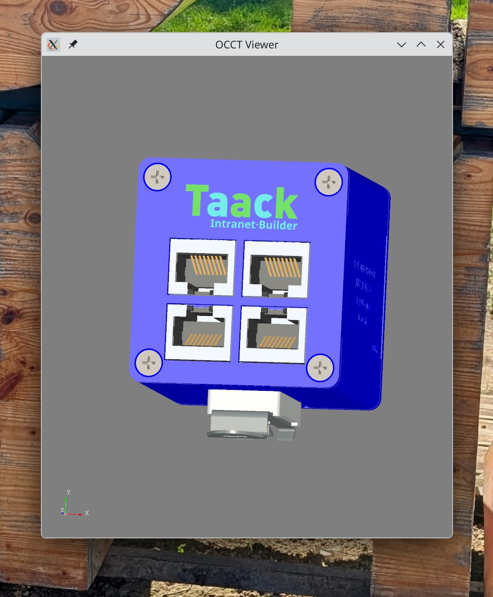

= DSL for CAD Bodies and Assemblies
:icons: font

The purpose of this tool is to share 3D parts and assemblies like java class binaries.

The DSL does not cover every way to define a body yet, and assemblies place and animate parts without a solver.

== Sharing Parts as Jars

A part is a Groovy class built with the DSL: compiled against `cad-dsl` alone, without OCCT nor native code, it is
shared as an ordinary jar, published to a Maven repository like any library. A project declares it as a dependency and
its scripts use the part as any class:

[source,groovy]
----
dependencies {
    cadImplementation 'org.taack:cad-dsl:0.1'
    cadImplementation 'org.example.cad:parts:0.1'   // the shared parts
}
----

[source,groovy]
----
import org.example.parts.Plate

Plate.drilled(80, 40, 4, 6).display()
----

The IntelliJ plugin completes the parts, and runs the scripts with the classpath of their module: the jars Gradle
resolved, the classes of the modules they depend on. See xref:docs/usage.adoc#sharing-parts[Sharing Parts as Jars], and
the example project in `cad-dsl-intellij/example`.

.Assembly, with svg

== Modules

* `cad-dsl`: the DSL (`org.taack.cad.dsl`), in pure Groovy. Models only need it to compile, and it builds without OCCT.
* `cad-dsl-occt`: the Open CASCADE kernel running the DSL (`org.taack.cad.occt`, with `CadDslVisitor`), and the jextract bindings.
  It also holds two low-level packages, not meant for models:
** `org.taack.cad.builder`, a builder API to try what OCCT can do before it gets into the DSL;
** `org.taack.cad.binding` (tests), direct calls to the OCCT symbols bound by jextract.
* `cad-dsl-native`: the C API over OCCT, loaded by `cad-dsl-occt`.
* `cad-dsl-freecad`: the FreeCAD kernel (`org.taack.cad.freecad`), building the models in a `FreeCADCmd` process, and
  saving them as editable FCStd files, their parameters in a spreadsheet (see xref:docs/freecad.adoc[FreeCAD Kernel]).
* `cad-dsl-step`: `step2dsl`, converting STEP files to DSL scripts, with FreeCAD (see xref:docs/freecad.adoc#step-to-dsl[STEP to DSL]).
* `cad-dsl-runner`: runs the scripts on request, for an IDE showing them as glTF (see xref:docs/usage.adoc#runner[Runner]).
* `cad-dsl-intellij`: the IntelliJ IDEA plugin, completing the scripts, running them in the runner and previewing their models
  in 3D (see xref:docs/usage.adoc#intellij-plugin[IntelliJ Plugin]).

The DSL finds its kernel at runtime with `ServiceLoader` (`org.taack.cad.dsl.kernel.CadKernel`), so `cd()` works as soon as
`cad-dsl-occt` is on the classpath and `cad-dsl-native` in `java.library.path` (see xref:docs/building.adoc#native-library[Native Library]), or
`cad-dsl-freecad` is on the classpath and FreeCAD installed.

The tests of the DSL are in `cad-dsl/src/testFixtures`: they need a kernel, and each kernel module runs them with its own
(see `gradle/kernel-tests.gradle`). A kernel lacking a capability excludes the tests tagged with it (`images`, `colors`,
`gltf`).

== Documentation

* xref:docs/dsl.adoc[DSL]: parts, booleans, drafts, outlines, helices, wings, thru sections, plates, text and SVG.
* xref:docs/assemblies.adoc[Assemblies and Animations]: parts placed with joints, animated with laws and gears.
* xref:docs/usage.adoc[Distribution and Usage]: Maven artifacts, scripts, the runner, code completion and the IntelliJ plugin.
* xref:docs/freecad.adoc[FreeCAD Kernel]: FCStd files with their parameters, and STEP to DSL.
* xref:docs/building.adoc[Building]: the native library on Linux, macOS and Windows, and the native bindings.
