= DSL for CAD Bodies and Assemblies
:icons: font
:toc:
:toclevels: 2

The purpose of this tool is to share 3D parts and assemblies like java class binaries.

The DSL does not cover every way to define a body yet, and assemblies place and animate parts without a solver.

.Assembly, with svg
image::mj32.jpg[]

== Modules

* `cad-dsl`: the DSL (`org.taack.cad.dsl`), in pure Groovy. Models only need it to compile, and it builds without OCCT.
* `cad-dsl-occt`: the Open CASCADE kernel running the DSL (`org.taack.cad.occt`, with `CadDslVisitor`), and the jextract bindings.
  It also holds two low-level packages, not meant for models:
** `org.taack.cad.builder`, a builder API to try what OCCT can do before it gets into the DSL;
** `org.taack.cad.binding` (tests), direct calls to the OCCT symbols bound by jextract.
* `cad-dsl-native`: the C API over OCCT, loaded by `cad-dsl-occt`.
* `cad-dsl-freecad`: the FreeCAD kernel (`org.taack.cad.freecad`), building the models in a `FreeCADCmd` process, and
  saving them as editable FCStd files, their parameters in a spreadsheet (see <<FreeCAD Kernel>>).
* `cad-dsl-step`: `step2dsl`, converting STEP files to DSL scripts, with FreeCAD (see <<STEP to DSL>>).

The DSL finds its kernel at runtime with `ServiceLoader` (`org.taack.cad.dsl.kernel.CadKernel`), so `cd()` works as soon as
`cad-dsl-occt` is on the classpath and `cad-dsl-native` in `java.library.path` (see <<Native Library>>), or
`cad-dsl-freecad` is on the classpath and FreeCAD installed.

The tests of the DSL are in `cad-dsl/src/testFixtures`: they need a kernel, and each kernel module runs them with its own
(see `gradle/kernel-tests.gradle`). A kernel lacking a capability excludes the tests tagged with it (`images`, `colors`).

== DSL

WARNING: The DSL is evolving.

It takes inspiration from https://github.com/CadQuery/cadquery[CadQuery], in Groovy. The tests in
`cad-dsl/src/testFixtures/groovy/org/taack/cad/dsl` give an overview of its constructions; the examples below come from them.

`display()` opens the shape in an interactive OCCT viewer window, `display("x.png")` renders it off-screen
(the images of this README are made this way), and `display("x.step")` / `display("x.stl")` export it.

NOTE: Without FreeImage support in OCCT (`-DUSE_FREEIMAGE=ON`), `display("x.png")` writes PPM data whatever the extension.

=== A First Part

.Pillow Block with Counterbored Holes and Prism
[source,groovy]
----
@Test
void "Pillow Block With Counterbored Holes and Prism"() {
    cd().box(length, height, thickness).topZ().wireFrom() {
        double rectSX = length - cboreInset
        double rectSY = height - cboreInset
        [[-rectSX / 2, -rectSY / 2], [0, rectSY],
         [rectSX, 0], [0, -rectSY]].each { double cX, double cY ->
            move(cX, cY)
            circle(centerHoleDia)
        }
    }.toFace().hole(-cboreHoleDiameter).topZ().wireFrom() {
        circle(centerHoleDia)
    }.toFace().prism(cboreHoleDiameter).display()
}
----

.Pillow Block Result
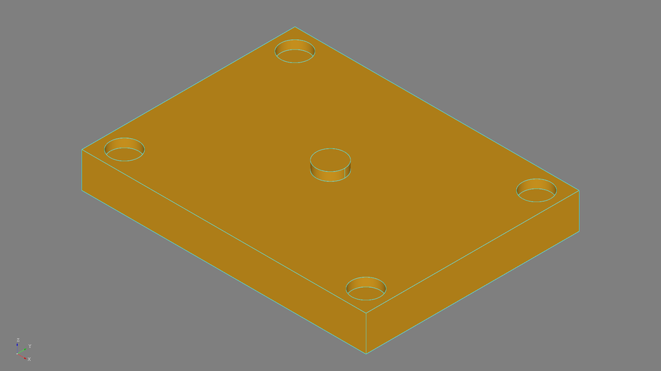

=== Boolean Operations

`cut { ... }`, `fuse { ... }` and `common { ... }` combine the current solid with the solids made in their closure.

.Cut 3 Boxes
[source,groovy]
----
@Test
void "Test cut 3 boxes"() {
    cd().box(1, 1, 1).cut {
        position(new Vec(1, 1, 1) * 0.6) {
            box(1, 1, 1)
        }
        position(new Vec(1, 1, 1) * -0.6) {
            box(1, 1, 1)
        }
    }.display()
}
----

.Cut 3 Boxes Result
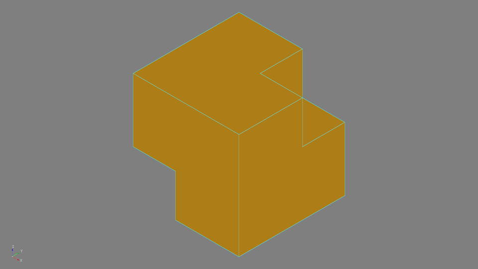

.Cut Version
[source,groovy]
----
@Test
void "Test mix fuse - common - cut"() {
    Vec diagonal = new Vec(1, 1, 1)

    cd().box(2, 2, 1).cut {
        position(diagonal * 0.4) {
            box(1, 1, 1)
            position(diagonal * 0.3) {
                cylinder(1 / 2, 3)
            }
        }
        position(diagonal * 0.6) {
            box(1, 1, 1)
        }
    }.display()
}
----

.Cut Result
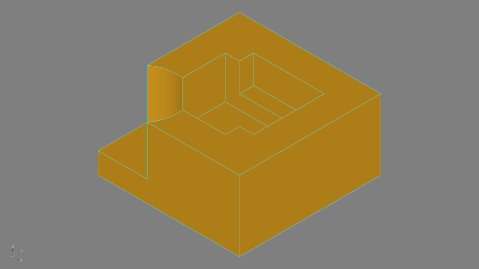

.Fuse Version
[source,groovy]
----
@Test
void "Test mix fuse - common - fuse"() {
    Vec diagonal = new Vec(1, 1, 1)

    cd().box(2, 2, 1).fuse {
        position(diagonal * 0.4) {
            box(1, 1, 1)
            position(diagonal * 0.3) {
                cylinder(1 / 2, 3)
            }
        }
        position(diagonal * 0.6) {
            box(1, 1, 1)
        }
    }.display()
}
----

.Fuse Result
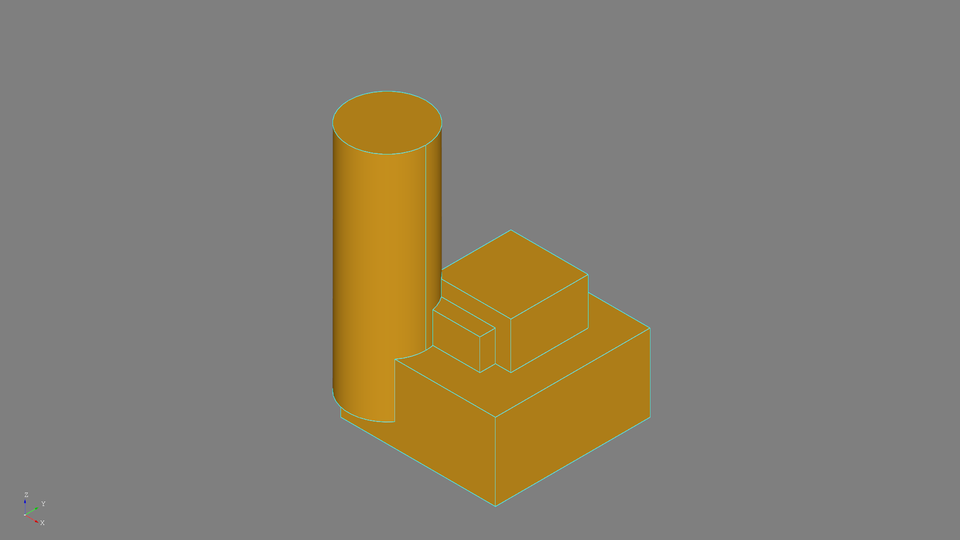

=== Drafts

`prism(dir, draft: degrees)` and `hole(dir, draft: degrees)` make prisms whose side faces lean by the draft angle, as
the walls of a molded part: the section narrows along `dir`, normal to the face (it widens for a negative draft), and
the walls of the holes of the face lean the other way. A hole with a positive draft is a pocket narrower at its bottom.

.Molded Tray
[source,groovy]
----
@Test
void "Molded tray, its walls and pockets with a draft"() {
    // walls leaning 3° inward, a ring with a draft on its top, then a pocket beside it, narrower at its bottom
    cd().wireFrom(new Vec(-40, -30, 0)) {
        edge(new Vec(40, -30, 0))
        edge(new Vec(40, 30, 0))
        edge(new Vec(-40, 30, 0))
        edge(new Vec(-40, -30, 0))
    }.toFace().prism(new Vec(0, 0, 20), draft: 3)
            .topZ().wireFrom() {
                circle(12)
                circle(6, true)
            }.toFace().prism(8, draft: 5)
            .topZ(new Vec(25, 0, 21)).wireFrom() {
                circle(5)
            }.toFace().hole(-10, draft: 2).display()
}
----

=== Helix

`helix(radius, pitch, height[, endRadius])` starts a helix around the current direction (a negative pitch makes it
left-handed, `endRadius` makes it conical). `wire(radius)` sweeps a circle along it, `profile(from) { ... }` sweeps
any closed profile drawn with the usual 2D edges. The profile lies in the axial plane at the start of the helix:
`x` goes away from the axis, `y` goes along it, and `(0, 0)` is the start point of the helix.

.Spring
[source,groovy]
----
@Test
void "Spring"() {
    cd().helix(10, 4, 40).wire(1).display()
}
----

.Spring Result
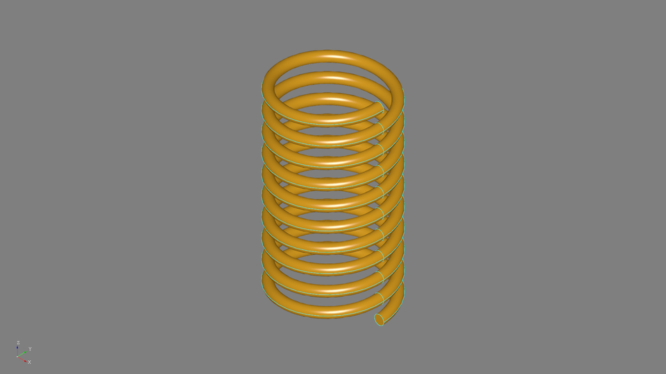

Swept in a `fuse`, a trapezoid profile threads the neck of the bottle:

.Bottle Threading with `helix`
[source,groovy]
----
static CadDsl helixThreading(CadDsl s) {
    double depth = myNeckRadius / 12
    double pitch = myNeckHeight / 4

    Vec2d pOri = new Vec2d(-depth / 3, -pitch / 3)
    Vec2d p2 = new Vec2d(depth, -pitch / 12)
    Vec2d p3 = new Vec2d(depth, pitch / 12)
    Vec2d p4 = new Vec2d(-depth / 3, pitch / 3)

    s.fuse {
        position(new Vec(myHeight + pitch / 2)) {
            direction(new Vec(1))
            helix(myNeckRadius, pitch, myNeckHeight - 1.5 * pitch).profile(pOri) {
                edge(p2)
                edge(p3)
                edge(p4)
                edge(pOri)
            }
        }
    }.toCadDsl()
}
----

.Bottle Neck Threaded with `helix`
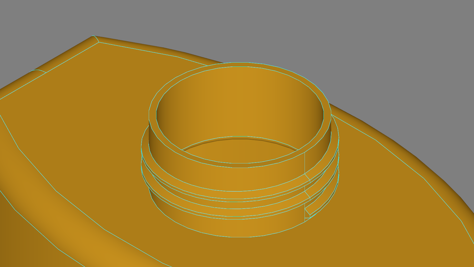

=== Wings and Propellers

`wing { ... }` lofts through the sections declared with `section(leadingEdge, chord[, twist])`. From the current
position, the chord goes along X, the span along Y and the thickness along Z. Each section is drawn for a unit chord
(`x` from the leading edge at 0 to the trailing edge at 1, `y` for the thickness) with `profile(from) { ... }`, where
`spline(...)` draws a smooth curve through points, or with `naca('2412')` for a NACA 4-digit airfoil. It is then
scaled to the chord, twisted in degrees around the quarter chord (positive nose up) and moved to its leading edge.

.Wing with Free Profile Sections
[source,groovy]
----
@Test
void "Wing with Free Profile Sections"() {
    Vec2d te = new Vec2d(1, 0)
    Vec2d le = new Vec2d(0, 0)

    cd().wing {
        section(new Vec(), 2).profile(te) {
            spline(new Vec2d(0.5, 0.09), new Vec2d(0.15, 0.08), le)
            spline(new Vec2d(0.15, -0.04), new Vec2d(0.5, -0.03), te)
        }
        section(new Vec(0.3, 5, 0.3), 1.6, -1).profile(te) {
            spline(new Vec2d(0.5, 0.08), new Vec2d(0.15, 0.07), le)
            spline(new Vec2d(0.15, -0.035), new Vec2d(0.5, -0.025), te)
        }
        section(new Vec(0.9, 8, 0.8), 0.8, -3).profile(te) {
            spline(new Vec2d(0.5, 0.06), new Vec2d(0.15, 0.05), le)
            spline(new Vec2d(0.15, -0.03), new Vec2d(0.5, -0.02), te)
        }
    }.display()
}
----

.Wing Result
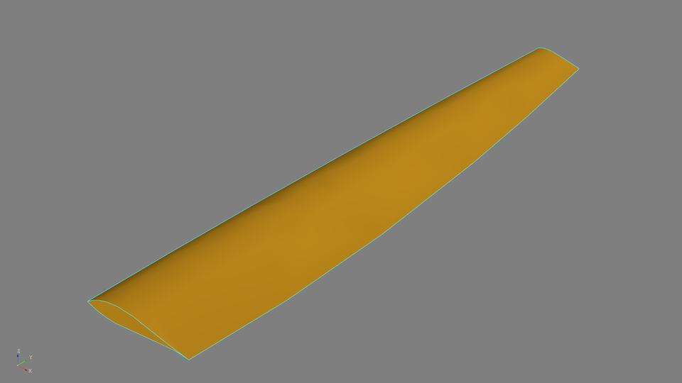

`circularPattern(count[, axis]) { ... }` repeats the solids made in its closure around an axis (Z by default) through
the current position; the copies join the enclosing `fuse`, `cut` or `common`. With `CadDslWing.pitchTwist(pitch, radius)`,
which gives the twist of a blade section for a propeller pitch, it makes propellers:

.Three-blade Propeller
[source,groovy]
----
@Test
void "Three-blade Propeller"() {
    double hubRadius = 1.5
    double hubLength = 3
    double pitch = 6
    double tipRadius = 8
    // chord along the blade, from the root (inside the hub) to the tip
    Map<Double, Double> chords = [1.2d: 1.2d, 3d: 1.6d, 5.5d: 1.3d, 8d: 0.5d]

    cd().position(new Vec(-hubLength / 2)) {
        cylinder(hubRadius, hubLength)
    }.fuse {
        circularPattern(3) {
            wing {
                chords.each { double r, double chord ->
                    // quarter chord on the blade axis, twisted like a helix of the propeller pitch
                    section(new Vec(-chord / 4, r, 0), chord, CadDslWing.pitchTwist(pitch, r)).naca(r < tipRadius ? '4412' : '0010')
                }
            }
        }
    }.display()
}
----

.Propeller Result
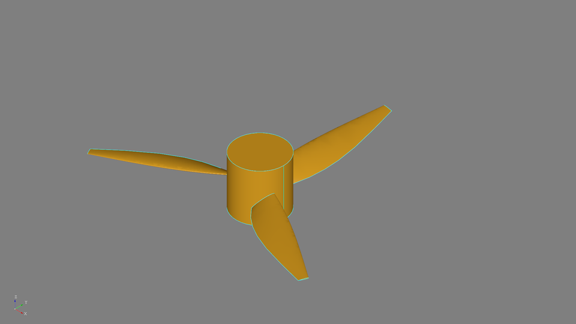

=== Thru Sections

`thruSection { ... }` lofts a solid through closed wires drawn on surfaces, in the order they are declared. Where a
wing lofts flat sections, it follows a curved face. Like `helix`, put it in a `fuse`, `cut` or `common` to join the
current solid.

* `cylindricalSurface(radius)` sets the surface the next wires are drawn on: a cylinder around the current direction,
  through the current position. Set inside `position(...) { ... }`, it is kept once the position ends.
* `wireFromSurface { ... }` draws a wire on that surface with the usual 2D edges, in the (u, v) parameters of the
  surface. On a cylinder, `u` is the angle around the axis in radians, and `v` the distance along the axis from the
  position: a straight edge winds around the cylinder as a helix.
* `trimmed(curve, u1, u2)` keeps the part of a closed curve (`ellipse`, `circle`) between two of its parameters, as an
  edge of the wire; `start` and `end` give its ends. The closed curve itself is a construction, not part of the wire.

`ellipse(dir, majorRadius, minorRadius)` is centered on the current point, its major axis along `dir`.

The OCCT bottle tutorial threads the neck this way. On two coaxial cylinders, a wire goes from a half ellipse back to
its start: the chord winds around the neck, and the arc bulges beside it. The outer ellipse is a quarter as thick as
the inner one, so the loft tapers from the neck to the crest of the thread.

.Bottle Threading with `thruSection`
[source,groovy]
----
static CadDsl simpleThreading(CadDsl s) {
    double aMajor = 2 * PI
    double aMinor = myNeckHeight / 10
    Vec2d pos = new Vec2d(2 * PI, myNeckHeight / 2)
    Vec2d dir = new Vec2d(2 * PI, myNeckHeight / 4)

    s.fuse {
        thruSection {
            position(new Vec(myHeight)) {
                direction(new Vec(1))
                cylindricalSurface(myNeckRadius * 0.99)
            }

            wireFromSurface {
                to(pos)
                ITrimmable2d thread = trimmed(ellipse(dir, aMajor, aMinor), 0, PI)
                edge(thread.start)
            }

            position(new Vec(myHeight)) {
                direction(new Vec(1))
                cylindricalSurface(myNeckRadius * 1.05)
            }

            wireFromSurface {
                to(pos)
                ITrimmable2d thread = trimmed(ellipse(dir, aMajor, aMinor / 4), 0, PI)
                edge(thread.start)
            }
        }
    }.toCadDsl()
}
----

.Bottle Neck Threaded with `thruSection`
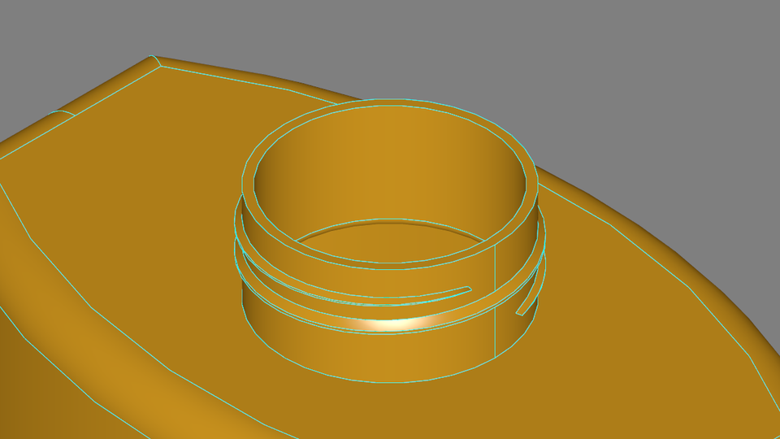

=== Plate Surfaces

`plate { ... }` fills a 3D contour with a smooth surface and returns it as a face, so `prism(...)` or `revolution(...)`
make a solid of it. Like the sections of a wing, its constraints are drawn relative to the current position:

* `boundary(from) { ... }` draws the contour, a closed wire drawn as with `wireFrom(Vec)` (`edge`, `arc`), once; the
  face is trimmed by it, whatever its number of sides;
* `curve(from) { ... }` draws a curve the surface passes through, as many as needed;
* `through(points...)` makes the surface pass through points.

The constraints are positional (G0). `plate(degree: 3, pointsOnCurve: 15, iterations: 2, tolerance: 1e-4,
maxSegments: 9, maxDegree: 8) { ... }` tunes the plate surface and its BSpline approximation; these are the defaults.

.Solid Under a Plate Surface
[source,groovy]
----
static CadDslFace plateWithInnerCurve() {
    Vec p1 = new Vec(0, 0, 0)
    Vec p2 = new Vec(10, 0, 0)
    Vec p3 = new Vec(10, 10, 0)
    Vec p4 = new Vec(0, 10, 0)

    cd().plate {
        boundary(p1) {
            arc(p2, new Vec(5, -1, 1))
            edge(p3)
            arc(p4, new Vec(5, 11, 1))
            edge(p1)
        }
        // a ridge across the plate
        curve(new Vec(2, 5, 1)) {
            arc(new Vec(8, 5, 1), new Vec(5, 5, 4))
        }
    }
}

static CadDslSolid solidUnderPlate() {
    plateWithInnerCurve().prism(new Vec(0, 0, -2))
}
----

.Plate Result
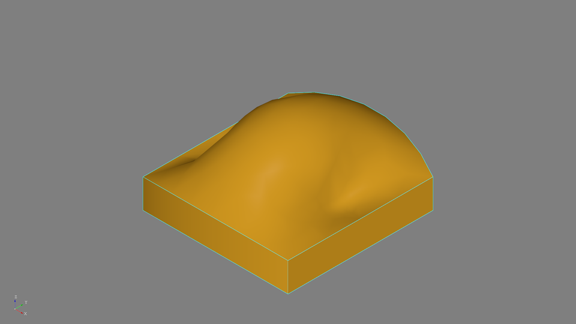

=== Text

`text(content, size)` draws the contours of a line of text at the current position of a sketch, in a TrueType or
OpenType font. The letters join the other contours of the sketch: `toFace()` makes a face of each, with its holes (the
inside of an `O`, an `e`), so `prism(...)` embosses the text and `hole(...)` engraves it. `size` is the size of the font
in model units; the capitals are about 0.7 of it, depending on the font.

* On a face (`topZ().wireFrom() { ... }`), the text runs along the u direction of the face and reads from outside it;
  `angle:` turns it, in degrees.
* In a 3D wire (`wireFrom(new Vec(...)) { ... }`), it starts at the current point, in absolute coordinates:
  `direction:` along the text (X by default), `normal:` the side it reads from (Z by default).

Its other options: `font:` a font name, found among the fonts of the system (`sans-serif` by default, `serif`,
`monospace`, or a family such as `'Liberation Serif'`), or the path of a font file; `bold:`, `italic:`; `align:` the
current position at the `left` (default), `center` or `right` of the text; `valign:` at its `bottom` (default, the
baseline), `center` or `top`.

.Embossed Text and a Circle in the Same Sketch (`TextTest`)
[source,groovy]
----
cd().box(60, 20, 5).topZ().wireFrom() {
    text('CITEL', 6, font: 'serif', bold: true, align: 'center', valign: 'center')
    move(-22, 0)
    circle(3)
}.toFace().prism(1).display()
----

.Text Result
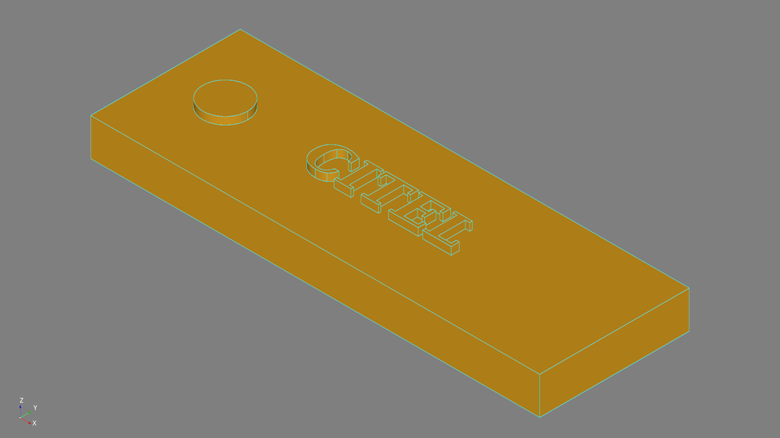

NOTE: Text needs OCCT built with FreeType (`-DUSE_FREETYPE=ON`), which the Windows build below turns off.

=== SVG Drawings

`svg(source, width)` draws the filled shapes of an SVG drawing at the current position of a sketch, as `text` does:
its contours join the other ones of the sketch, the contours inside others are holes (the even-odd rule), and
`prism(...)` or `hole(...)` emboss or engrave the drawing. `source` is an SVG document, the path of an SVG file, or
the data of a single path (its `d` attribute); `width` is the width of the drawing, of its bounding box, in model
units.

The SVG `y` axis, down, is turned up. On a face, the `x` axis of the drawing runs along the u direction of the face,
`angle:` turns it; in a 3D wire, `direction:` and `normal:` set it, as for a text. `align:` (`left`, `center`,
`right`) and `valign:` (`bottom`, `center`, `top`) put the current position on the bounding box of the drawing, at its
bottom left by default.

It reads `path` (every command), `rect` (rounded too), `circle`, `ellipse`, `polygon` and `polyline`, in groups, with
their `transform`. Arcs of circle stay exact when the transforms keep circles; other arcs, and quadratic curves,
become cubic Bezier curves. Shapes not filled (`fill="none"`), hidden ones, and the content of `defs`, `clipPath`,
`mask`, `pattern`, `marker` and `symbol` are left out. Strokes are not read: convert them to paths first (Inkscape:
_Path > Stroke to Path_).

.Embossed Sun of the CITEL Logo (`SvgTest`)
====
The sun of the CITEL logo, `citel-sun.svg`, is a single path of lines and arcs: a disc, with the rays of
the sun cut out of it.

[source,groovy]
----
cd().box(30, 30, 5).topZ().wireFrom() {
    svg('citel-sun.svg', 20, align: 'center', valign: 'center')
}.toFace().prism(1).display()
----

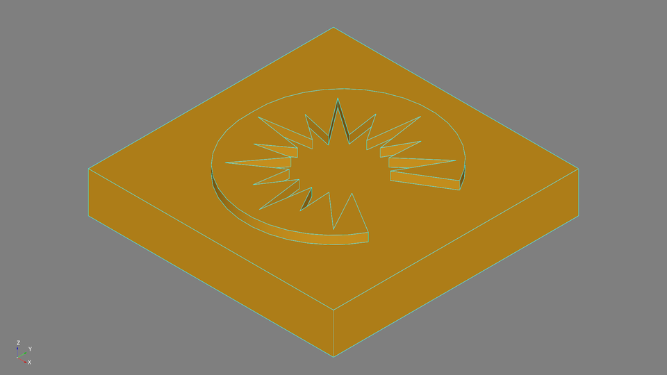
====

=== Assemblies

`assembly([name]) { ... }` assembles parts and sub-assemblies:

* `part([name], [color]) { ... }` declares a part, built with the usual DSL (as from `cd()`) in its own coordinates;
  `part(solid, [name], [color])` uses a solid already built. Without color, a part keeps the kernel default one.
* `assembly([name]) { ... }` declares a sub-assembly.
* `place(part) { ... }` puts an occurrence of a part, or of a sub-assembly, in the assembly, as many times as needed,
  and returns it (`CadDslInstance`). Its closure positions it:
** `mate(connector, target)` puts a connector of the part on a connector of the assembly, face against face: same
   origin, opposite normals, same x direction;
** `align(connector, target)` makes them coincide: same origin, same z and x directions, e.g. coaxial axes;
** or a joint, `revolute` or `slider`, see <<Animations>>;
** then `translate(vec)` or `translate(x, y, z)` and `rotate(axis, degrees[, around])` move it, in the order they are
   written, in the assembly coordinates.
* `body([color]) { ... }` and `body(solid[, color])` are shortcuts for a part placed once, where it was built.

Connectors are frames on planar faces, taken with the same selectors as solids: `topZ()` is the face facing +Z the
farthest along Z, `butX(pos)` the face facing -X closest to `pos`, with the origin at `pos` projected on it, and so on.
`axis()` is on the axis of the cylindrical face of largest radius (a shaft, a hole), `axis(pos)` of the one closest to
`pos`: its z is the axis direction, pointing to +Z (else +Y, else +X) in the part coordinates, and its origin the start
of the face along the axis, or `pos` projected on it.

On a part (or, in `place`, without receiver: the part placed) they are in the part coordinates; on an instance, in the
coordinates of its assembly. `instance.at(connector)` brings the connector of an instance inside a sub-assembly to the
coordinates of the assembly where the sub-assembly is placed. A connector is adjusted with `offset(distance)` along its
z (on a face, positive: a gap, negative: sunk into the face; on an axis, it slides along it), `rotate(degrees)`
around it, and `reverse()` turns its z the other way. Its x direction belongs to the
part (global X projected on the face, in the part coordinates), so that mated parts follow each other's orientation.

Colors are `Color.RED`, `Color.ORANGE`, ..., `Color.rgb(255, 136, 0)`, `Color.hex('#ff8800')` or `new Color(1, 0.5, 0)`.

`display()` shows every part with its color. To a `.step` file, the assembly tree is kept, with names and colors, and
a part or sub-assembly placed several times is written once; to a `.stl` file, the parts are merged (STL has neither
parts nor colors).

.Cart: a chassis on two axles, each axle a sub-assembly (`AssemblyTest`)
[source,groovy]
----
assembly('cart') {
    def chassis = part('chassis', Color.hex('#3080ff')) {
        box(40, 20, 4)
    }
    def wheel = part('wheel', Color.ORANGE) {
        cylinder(5, 2).cut { cylinder(1, 2) }
    }
    CadDslInstance shaft = null, outerWheel = null
    def axle = assembly('axle') {
        shaft = place(part('shaft') { cylinder(1, 26) })
        // on the shaft, flush with its ends
        place(wheel) { align(axis(), shaft.axis()) }
        outerWheel = place(wheel) { align(axis(), shaft.axis().offset(24)) }
    }
    def c = place(chassis) { translate(-20, 0, 4) }
    // under the chassis, 3 mm out of its sides
    place(axle) { mate(shaft.butZ(), c.butY(new Vec(-14, 0, 3)).offset(-23)) }
    def rear = place(axle) { mate(shaft.butZ(), c.butY(new Vec(14, 0, 3)).offset(-23)) }
    place(part('cap', Color.RED) { cylinder(2, 0.5) }) { mate(butZ(), rear.at(outerWheel.topZ())) }
}.display()
----

.Cart Result
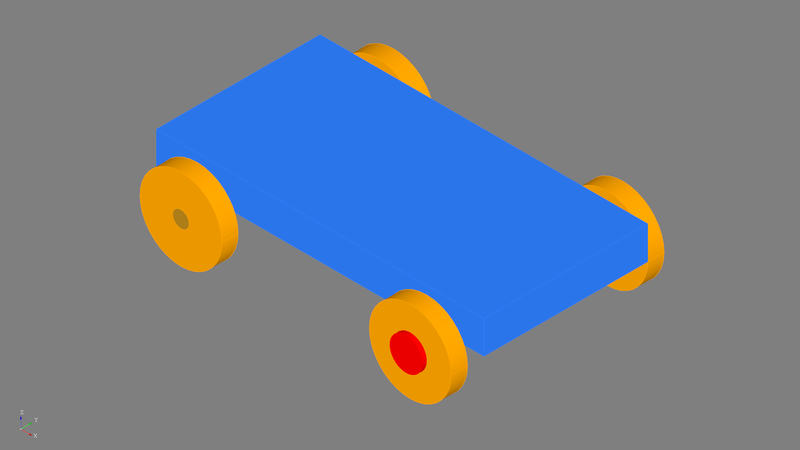

=== Animations

Joints place a part like `align`, leaving it a degree of freedom:

* `revolute(connector, target[, degrees])` turns the part around the z of the connectors: a hinge, a wheel on its shaft;
* `slider(connector, target[, distance])` moves it along their z: a piston, a drawer.

`animate(duration: seconds[, fps: 25]) { ... }` drives them with laws of the time `t` in seconds:
`instance.angle = { double t -> ... }` (degrees) for a revolute joint, `instance.distance = { double t -> ... }` for a
slider. `gear(driver, driven, ratio)` makes the joint of `driven` follow the one of `driver`: driven value = ratio *
driver value. For gears of z1 (driver) and z2 teeth, ratio = -z1 / z2; from a pinion of pitch radius r to a rack,
ratio = PI * r / 180 per degree.

Parts placed on a moving instance (with `mate`, `align` or a joint on one of its connectors) follow it, through
sub-assemblies too. There is no solver: the parts depend on each other as a tree, so closed loops (a crank and its
connecting rod) need their law computed in the closure, see <<Crank and Slider>>.

`display()` plays the animation in a loop, `display('frames/%03d.png')` renders each frame (a `String.format` pattern),
to be turned into a video or a GIF, e.g. with `ffmpeg` or ImageMagick. STEP, STL and single images show it at `t = 0`.

.Gear Train: two gears and a rack (`AnimationTest`)
[source,groovy]
----
assembly('gear train') {
    // Parts
    def basePart = part('base', Color.GRAY) { box(60, 30, 2) }
    def pinPart = part('pin', Color.RED) { cylinder(0.5, 4) }
    def rackPart = part('rack', Color.GREEN) { box(4, 50, 3) }
    // a disc with a marker on top
    def wheel = { double radius, Color color ->
        part(color) {
            cylinder(radius, 3).fuse {
                position(new Vec(radius - 3, -1, 3)) { box(2, 2, 2) }
            }
        }
    }

    // Placements
    def base = place(basePart) { translate(-20, -15, -2) }
    def big = place(wheel(10, Color.ORANGE)) {
        revolute(axis(), base.topZ(new Vec(0, 0, 0)))
    }
    def small = place(wheel(5, Color.BLUE)) {
        revolute(axis(), base.topZ(new Vec(15, 0, 0)))
    }
    // pins on top of the gears, they turn with them
    place(pinPart) { align(butZ(), small.topZ(new Vec(12, 0, 3)).reverse()) }
    place(pinPart) { align(butZ(), big.topZ(new Vec(-6, 0, 3)).reverse()) }
    // against the small gear, sliding along Y from the side of the base
    def rack = place(rackPart) {
        slider(butY(), base.butY(new Vec(22, -15, 1.5)))
    }

    // Motion
    gear(big, small, -2)
    // the rack moves by the arc length of the small gear, towards +Y (against its slider z)
    gear(small, rack, -PI * 5 / 180)
    animate(duration: 4, fps: 12) {
        big.angle = { double t -> -45 * t }
    }
}.display()
----

.Gear Train Result
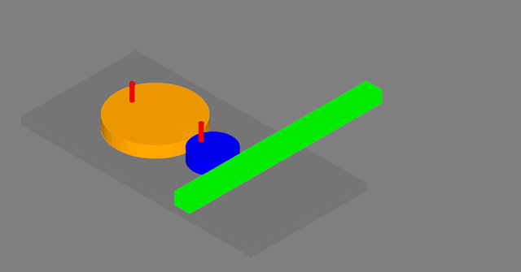

==== Crank and Slider

The crank, its rod and the piston make a closed loop: the rod is placed on the crank pin, the piston slides on its own,
and nothing makes the rod end meet the piston. Their laws do: from the crank angle `a`, the rod end rises to
`r sin(a) + sqrt(l² - (r cos(a))²)` above the crank axis, which gives the piston height and the rod angle.

.Crank and Slider (`AnimationTest`)
[source,groovy]
----
assembly('crank and slider') {
    // crank radius, rod length
    double r = 8, l = 24
    // Parts
    def basePart = part('base', Color.GRAY) { box(30, 24, 2) }
    def wallPart = part('wall', Color.hex('#a0a8b0')) { box(30, 4, 60) }
    def crankPart = part('crank', Color.ORANGE) {
        cylinder(4, 3).fuse {
            position(new Vec(0, -2, 0)) { box(r, 4, 3) }
            position(new Vec(r, 0, 0)) { cylinder(1, 6) }
        }
    }
    def rodPart = part('rod', Color.BLUE) {
        cylinder(2.5, 2).fuse {
            position(new Vec(0, -1, 0)) { box(l, 2, 2) }
            position(new Vec(l, 0, 0)) { cylinder(2.5, 2) }
        }
    }
    def pistonPart = part('piston', Color.RED) {
        position(new Vec(-5, -4, 0)) { box(10, 8, 8) }
    }

    // Placements
    def base = place(basePart) { translate(-15, -20, -2) }
    def wall = place(wallPart) { translate(-15, 0, 0) }
    // its axis 15 mm high, out of the wall
    def crank = place(crankPart) {
        revolute(axis(), wall.butY(new Vec(0, 0, 15)))
    }
    // on the crank pin, in front of the crank
    def rod = place(rodPart) {
        revolute(axis(new Vec(0, 0, 0)), crank.at(crankPart.axis(new Vec(r, 0, 3))))
    }
    // its bottom on the rod end, sliding up from the base, against the wall
    def piston = place(pistonPart) {
        slider(butZ().reverse(), base.topZ(new Vec(0, -4, 0)))
    }

    // Motion: one turn in 2 s
    // height of the rod end above the crank axis, the crank at a degrees
    Closure<Double> rise = { double a ->
        r * sin(toRadians(a)) + sqrt(l * l - pow(r * cos(toRadians(a)), 2))
    }
    animate(duration: 2, fps: 25) {
        crank.angle = { double t -> 180 * t }
        // from the crank pin to the rod end, relative to the crank
        rod.angle = { double t ->
            double a = 180 * t
            toDegrees(atan2(rise(a) - r * sin(toRadians(a)), -r * cos(toRadians(a)))) - a
        }
        piston.distance = { double t -> 15 + rise(180 * t) }
    }
}.display()
----

.Crank and Slider Result
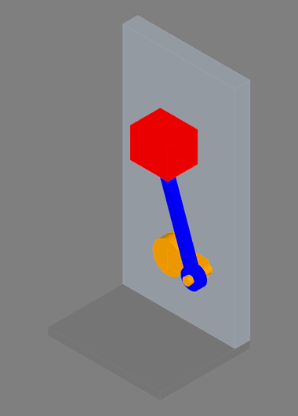

==== Animated Sub-assemblies

Joints animate inside sub-assemblies as well: the wheels turn on the shaft of the axle, the axle is placed twice in the
cart, and the cart slides on the ground. The laws and gears can link any joints of the tree: here, gears make the
wheels turn as the cart moves, so that they roll without slipping (a turn every `2 PI r` along the ground). A
sub-assembly placed several times moves the same way everywhere, as all its occurrences share it.

.Rolling Cart (`AnimationTest`)
[source,groovy]
----
assembly('rolling cart') {
    // Parts
    def groundPart = part('ground', Color.GRAY) { box(200, 40, 2) }
    def chassisPart = part('chassis', Color.hex('#3080ff')) { box(40, 20, 4) }
    def shaftPart = part('shaft') { cylinder(1, 26) }
    def wheelPart = part('wheel', Color.ORANGE) { cylinder(5, 2).cut { cylinder(1, 2) } }
    // a spoke on the outer face of the wheels, to see them turn
    def spokePart = part('spoke', Color.RED) {
        position(new Vec(-2, -0.5, 0)) { box(4, 1, 1) }
    }

    // Axle: the wheels turn on the shaft, the spokes with them
    CadDslInstance shaft = null, left = null, right = null
    def axle = assembly('axle') {
        shaft = place(shaftPart)
        left = place(wheelPart) { revolute(axis(), shaft.axis()) }
        right = place(wheelPart) { revolute(axis(), shaft.axis().offset(24)) }
        place(spokePart) { mate(butZ(), left.butZ(new Vec(3, 0, 0))) }
        place(spokePart) { mate(butZ(), right.topZ(new Vec(3, 0, 26))) }
    }

    // Cart: a chassis on two axles
    CadDslInstance chassis = null
    def cart = assembly('cart') {
        chassis = place(chassisPart) { translate(-20, 0, 4) }
        place(axle) { mate(shaft.butZ(), chassis.butY(new Vec(-14, 0, 3)).offset(-23)) }
        place(axle) { mate(shaft.butZ(), chassis.butY(new Vec(14, 0, 3)).offset(-23)) }
    }

    // Placements: the back of the chassis at the start of the ground, the wheels on it, sliding along +X
    def ground = place(groundPart) { translate(-100, -10, -2) }
    def rolling = place(cart) {
        slider(chassis.butX().reverse(), ground.butX(new Vec(-100, 10, 8)).reverse())
    }

    // Motion: the cart rolls 120 mm in 2 s, the wheels turn around -Y without slipping
    gear(rolling, left, -180 / (PI * 5))
    gear(rolling, right, -180 / (PI * 5))
    animate(duration: 2, fps: 25) {
        rolling.distance = { double t -> 60 * t }
    }
}.display()
----

.Rolling Cart Result
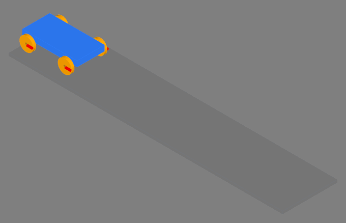

== Distribution and Usage

`cad-dsl` does not depend on native code: parts and assemblies compiled against it can be shared as plain jars.
Running them needs a kernel: `cad-dsl-occt`, and `cad-dsl-native` built for the platform (see <<Native Library>>).

=== Maven

Artifact coordinates:

.Maven
[source,groovy]
----
implementation 'org.taack.cad:cad-dsl:0.1'      // to write models
runtimeOnly 'org.taack.cad:cad-dsl-occt:0.1'    // to build them
----

NOTE: See https://github.com/Taack/cad-dsl-app/blob/main/cad-dsl-linux-app-x86-64/build.gradle[sample-build.gradle] to deal with JMOD files

Build `cad-dsl-native` for your platform (see <<Building>>), and put its directory in `java.library.path`.

=== Sample App Using the Artifacts

You can download a sample app: https://github.com/Taack/cad-dsl-app/tree/main/cad-dsl-linux-app-x86-64[cad-dsl-linux-app-x86-64].

=== Scripts

`cad-dsl` runs a model written as a Groovy script, without any project or test around it:

[source,bash]
----
./gradlew :cad-dsl-occt:installDist   # or distZip, to share it
cad-dsl-occt/build/install/cad-dsl/bin/cad-dsl samples/pillow-block.groovy             # <1>
cad-dsl-occt/build/install/cad-dsl/bin/cad-dsl samples/pillow-block.groovy block.step  # <2>
----

<1> Opens the shape in the viewer.
<2> The arguments following the script are available as `args`; this sample exports to the file given.

`cad-dsl` passes `CAD_DSL_OPTS` and `JAVA_OPTS` to the JVM: set `java.library.path` there (see <<Native Library>>).

[source,bash]
----
export CAD_DSL_OPTS="-Djava.library.path=$PWD/cad-dsl-native/build/lib/main/release"
----

From Gradle, `./gradlew :cad-dsl-occt:run --args="$PWD/samples/pillow-block.groovy"` sets it to the library just built.

The DSL packages (`org.taack.cad.dsl`, `.geom`, `.helper`), `CadDsl.cd()` and `java.lang.Math` are imported for the script:

.sphere.groovy
[source,groovy]
----
cd().position(new Vec(0, 0, 1)) {
    sphere(sqrt(4))
}.display(args ? args[0] : null)
----

Classes in the directory of the script are found too (`Contour.groovy` for a class `Contour`), to share parts
between scripts.

To get code completion, write the imports anyway (see `samples/pillow-block.groovy`) and open the scripts
in a project depending on `org.taack.cad:cad-dsl` only.

=== Code Completion

The DSL is statically typed: completion needs an IDE supporting Groovy `@DelegatesTo`, such as IntelliJ IDEA Community.
It only needs `cad-dsl` on the classpath, neither OCCT nor native code.

video::https://github.com/user-attachments/assets/c4763c7e-746c-4a55-a299-8d4375b2f001[]

== FreeCAD Kernel

`cad-dsl-freecad` runs the DSL in https://www.freecad.org[FreeCAD] 1.0 or later: each model is a FreeCAD document,
built by a `FreeCADCmd` process the kernel starts on first use. It makes features, not plain shapes: primitives
(`Part::Box`, `Part::Cylinder`...), sketches for the contours drawn on the faces, `Part::Extrusion` for the prisms and
the holes (its taper angle for the drafts), `Part::Revolution`, `Part::Cut`, `Part::MultiFuse`, fillets, lofts, sweeps along helices, fillings for the
plates, `Draft` shape strings for the texts. Assemblies are `App::Part` of `App::Link`.

`display("x.FCStd")` saves the document, editable in FreeCAD; `display("x.step")`, `.stl`, `.brep` and `.iges` export
the shape. `display()` checks the model, and opens it in FreeCAD with `-Dcad.freecad.gui=true` (the default of the
`cad-dsl-freecad` script). FreeCADCmd renders no images, and does not keep the colors (they belong to its GUI).

Declare the dimensions as parameters with `param(name, value)`: they go to the `Params` spreadsheet of the FCStd file,
and every number given to a feature equal to a parameter (or to its opposite) is bound to its cell: the dimensions of
the primitives, the lengths of the prisms, the radii of the circles and arcs of the sketches (as constraints), the
positions of the primitives and sketches. Change a cell in FreeCAD, and the model follows.

.samples/pillow-block-params.groovy
[source,groovy]
----
double length = param('length', 80)
double thickness = param('thickness', 10)
double holeRadius = param('holeRadius', 4)

cd().box(length, 60, thickness).topZ().wireFrom() {
    circle(holeRadius)
}.toFace().hole(-thickness).display(args ? args[0] : null)
----

[source,bash]
----
./gradlew :cad-dsl-freecad:installDist
cad-dsl-freecad/build/install/cad-dsl-freecad/bin/cad-dsl-freecad samples/pillow-block-params.groovy block.FCStd
----

NOTE: The binding goes by value: give the parameters distinct values, different from the other numbers of the model.
A parameter can also be set from outside the script: `-Dcad.param.thickness=12` (in `JAVA_OPTS`), with any kernel.

`FreeCADCmd` is found on the `PATH`, or set with the `freecad.cmd` system property (or `FREECAD_CMD`); the GUI is
`FreeCAD`, or the `freecad.gui` system property (or `FREECAD_GUI`).

Both kernels build the same solids from the shared tests, within 1% for the conical helices and the lofts (B-spline
approximations). FreeCAD is slower on large models: it recomputes the document at `display()`, and checks each boolean.

== STEP to DSL

`step2dsl` (`cad-dsl-step`) converts a STEP file to a DSL script rebuilding it. It reads the STEP file in FreeCAD, and
keeps its assembly tree: a part per distinct solid, a sub-assembly per distinct sub-assembly, placed as in the STEP file.
Each solid is recognized, from the simplest to the most general form:

* a primitive: a box along the axes, a cylinder, a sphere;
* a 2.5D solid, whose faces are all normal or parallel to an axis: prisms of its cross-sections;
* a solid of revolution: the revolution of its section by a half-plane through the axis;
* else a 2.5D base, the faces that do not fit removed (defeaturing), then the holes, pockets and bosses on it (the
  material removed from the base and added to it), each one a 2.5D solid, a primitive or a revolution.

Lines and arcs of circle are kept, the other curves become polylines; what is approximated is listed in the header of
the script. Free-form parts (molded, with drafts and B-spline faces) are approximated by stacks of prisms: their scripts
are long, slow to build, and FreeCAD may reject their booleans (its `CheckModel` preference).

[source,bash]
----
./gradlew :cad-dsl-step:installDist
cad-dsl-step/build/install/step2dsl/bin/step2dsl part.step part.groovy --check   # <1>
cad-dsl-freecad/build/install/cad-dsl-freecad/bin/cad-dsl-freecad part.groovy part.FCStd
----

<1> `--check` runs the script with the FreeCAD kernel, and prints how far what it builds is from the STEP file
(the volume of their symmetric difference); without a script file, the script goes to the standard output.

== Building

`./gradlew cad-dsl:build` only needs a JDK, `cad-dsl-freecad` and `cad-dsl-step` FreeCAD 1.0 or later. The native part requires https://github.com/Open-Cascade-SAS/OCCT[Open CASCADE Technology] 8.0 (C++17).
Use your distribution package if it ships 8.0, otherwise build it from source:

.Build OCCT 8.0.1 into a local prefix
[source,bash]
----
git clone --depth 1 --branch V8_0_1 https://github.com/Open-Cascade-SAS/OCCT.git occt
cmake -S occt -B occt/build -G Ninja -DCMAKE_BUILD_TYPE=Release \
      -DCMAKE_INSTALL_PREFIX=$HOME/.local/occt-8.0.1 -DUSE_FREETYPE=ON -DUSE_TBB=ON
cmake --build occt/build && cmake --install occt/build
----

Gradle looks for OCCT in `-PocctHome=<prefix>`, then the `OCCT_HOME` environment variable,
then `/usr` (Linux) or `/opt/homebrew` (macOS); Windows has no default. It links every `TK*` toolkit found in `<prefix>/lib`.
To avoid passing it each time, add `occtHome=/home/<you>/.local/occt-8.0.1` to `~/.gradle/gradle.properties`.

.Run the tests
[source,bash]
----
./gradlew -PocctHome=$HOME/.local/occt-8.0.1 cad-dsl-occt:test
./gradlew cad-dsl-freecad:test cad-dsl-step:test
./gradlew clean <1>
----

<1> To replay tests, you have to clean the env.

[[building-windows]]
=== Building on Windows

The native part builds with Visual C++ (Visual Studio 2022 or later, with the _Desktop development with C++_ workload),
which Gradle finds by itself. Build OCCT from a _Developer PowerShell for VS_, which provides CMake and Ninja:

.Build OCCT 8.0.1 on Windows
[source,powershell]
----
git clone --depth 1 --branch V8_0_1 https://github.com/Open-Cascade-SAS/OCCT.git occt
cmake -S occt -B occt/build -G Ninja -DCMAKE_BUILD_TYPE=Release `
      -DCMAKE_INSTALL_PREFIX=C:/occt-8.0.1 -DINSTALL_DIR_LAYOUT=Unix `
      -DBUILD_MODULE_Draw=OFF -DUSE_FREETYPE=OFF
cmake --build occt/build; cmake --install occt/build
----

* `INSTALL_DIR_LAYOUT=Unix` installs the headers in `include/opencascade`, the import libraries (`TK*.lib`) in `lib`
and the DLLs in `bin`, the layout Gradle expects. The default Windows layout (`inc`, `win64/vc14/lib`) is not supported.
* Turning off the Draw test harness and FreeType avoids the third party libraries (Tcl/Tk, FreeType) that OCCT does not ship:
the DSL needs neither. To keep them, point `-D3RDPARTY_DIR=<dir>` to their installs.

The OCCT DLLs must be in `PATH` when the tests run (see <<native-library-windows>>):

[source,powershell]
----
$env:PATH = "C:\occt-8.0.1\bin;$env:PATH"
.\gradlew -PocctHome=C:/occt-8.0.1 cad-dsl-occt:test
----

In `gradle.properties`, write the prefix with forward slashes: `occtHome=C:/occt-8.0.1`.
Build the library with `.\gradlew :cad-dsl-native:linkRelease` rather than `:cad-dsl-native:build`:
the C++ unit test (`src/test/cpp`) uses X11 and does not compile on Windows.

== Native Library

`cad-dsl-occt` calls OCCT through `cad-dsl-native`, a shared library built by `./gradlew :cad-dsl-native:linkRelease`
into `cad-dsl-native/build/lib/main/release/`. It is not in the jar: the JVM loads it with
`System.loadLibrary("cad-dsl-native")`, from `java.library.path`.

Two things must then be found at runtime:

. `cad-dsl-native` itself, by the JVM: put its directory in `java.library.path`.
. The OCCT libraries it links (every `TK*` toolkit of the install, and their own dependencies such as TBB, FreeType or Tcl/Tk), by the system loader.
On Linux and macOS, `cad-dsl-native` remembers the OCCT `lib` directory it was linked with (rpath),
so nothing has to be set on the machine where it was built.

The tests and `./gradlew :cad-dsl-occt:run` set `java.library.path` themselves.
Everywhere else, pass it to the JVM, along with `--enable-native-access=ALL-UNNAMED` to avoid the restricted method warnings:

[cols="1,3"]
|===
| Context | Setting

| `cad-dsl` launcher
| `CAD_DSL_OPTS="-Djava.library.path=<dir>"`

| `java`
| `java --enable-native-access=ALL-UNNAMED -Djava.library.path=<dir> -cp ... MyModel`

| Gradle project using the artifacts
| `tasks.withType(JavaExec).configureEach { systemProperty 'java.library.path', '<dir>' }`, and the same in `test { }`

| IntelliJ run configuration
| VM options: `-Djava.library.path=<dir> --enable-native-access=ALL-UNNAMED`
|===

When the library is missing, the first model fails with
`UnsatisfiedLinkError: no cad-dsl-native in java.library.path: <the directories searched>`;
when OCCT is missing, with an `UnsatisfiedLinkError` naming the OCCT library not found (e.g. `libTKernel.so.8.0: cannot open shared object file`).

=== Linux

* Library: `libcad-dsl-native.so`.
* `java.library.path` defaults to `LD_LIBRARY_PATH` followed by the system directories (`/usr/lib64:/lib64:/lib:/usr/lib`),
so `LD_LIBRARY_PATH=<dir>` works as well as `-Djava.library.path=<dir>`.
* OCCT: found through the rpath on the build machine. On another machine, install the same OCCT version
either in a system directory (distribution package, or a prefix registered with `ldconfig`),
or anywhere and add its `lib` directory to `LD_LIBRARY_PATH`.

=== macOS

* Library: `libcad-dsl-native.dylib`. OCCT is looked for in `/opt/homebrew` by default (`brew install opencascade`, if it ships 8.0).
* Pass `-Djava.library.path=<dir>` explicitly.
* OCCT: Homebrew libraries are referenced by their absolute path, and a self-built OCCT through the rpath,
so the build machine needs nothing more. On another machine, install OCCT at the same place,
or add its `lib` directory to `DYLD_LIBRARY_PATH`.
* System Integrity Protection removes the `DYLD_*` variables when launching protected programs such as `/usr/bin/java`:
start `$JAVA_HOME/bin/java` (as the `cad-dsl` launcher does when `JAVA_HOME` is set) rather than the `/usr/bin` one.

[[native-library-windows]]
=== Windows

* Library: `cad-dsl-native.dll`, built with Visual C++ (see <<building-windows>>).
* `java.library.path` defaults to the directories of `PATH`, so `PATH` works as well as `-Djava.library.path=<dir>`.
The `cad-dsl.bat` launcher reads `CAD_DSL_OPTS` too: `$env:CAD_DSL_OPTS = "-Djava.library.path=$PWD\cad-dsl-native\build\lib\main\release"`.
* OCCT: Windows has no rpath. The `bin` directory of the OCCT install, and those of the third party DLLs it was built with,
must be in `PATH`, on the build machine as on any other.
When they are missing, loading fails with `UnsatisfiedLinkError: ...cad-dsl-native.dll: Can't find dependent libraries`.

== Native Bindings

The Groovy code calls OCCT through a C API generated by jextract from
`cad-dsl-native/src/main/public/occt_capi.h`. This header is the only declaration of the
exported functions: the C++ implementation in `cad-dsl-native/src/main/cpp/capi/` includes it,
so a signature mismatch is a compile error.

* OCCT objects are opaque pointers; `OCCT_HANDLE(T)` is a heap-allocated `occ::handle<T>`.
* Release objects with `delete_<Type>`, handles with `delete_handle_<Type>`, and `double` arrays with `occt_free_doubles`.
* Flags are `int` (0 / 1).
* C++ exceptions never cross the boundary: a failing call returns `NULL` / `0`, and `occt_last_error()` gives the message.
