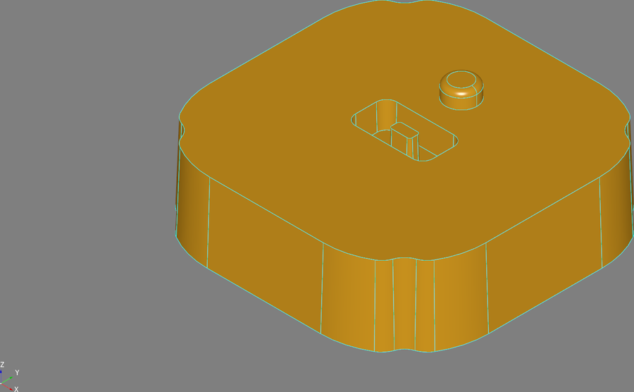

= DSL
:icons: font
:toc:
:toclevels: 2

xref:../README.adoc[Back to the README]

WARNING: The DSL is evolving.

It takes inspiration from https://github.com/CadQuery/cadquery[CadQuery], in Groovy. The tests in
`cad-dsl/src/testFixtures/groovy/org/taack/cad/dsl` give an overview of its constructions; the examples below come from them.

`display()` opens the shape in an interactive OCCT viewer window, `display("x.png")` renders it off-screen
(the images of this documentation are made this way), and `display("x.step")` / `display("x.stl")` export it.
`display("x.glb")` writes a binary glTF file: the faces and their boundaries as the viewer draws them, the tree of the
assembly and its animation, readable by any glTF viewer (see xref:usage.adoc#runner[Runner]).

NOTE: Without FreeImage support in OCCT (`-DUSE_FREEIMAGE=ON`), `display("x.png")` writes PPM data whatever the extension.

== A First Part

.Pillow Block with Counterbored Holes and Prism
[source,groovy]
----
@Test
void "Pillow Block With Counterbored Holes and Prism"() {
    cd().box(length, height, thickness).topZ().wireFrom() {
        double rectSX = length - cboreInset
        double rectSY = height - cboreInset
        [[-rectSX / 2, -rectSY / 2], [0, rectSY],
         [rectSX, 0], [0, -rectSY]].each { double cX, double cY ->
            move(cX, cY)
            circle(centerHoleDia)
        }
    }.toFace().hole(-cboreHoleDiameter).topZ().wireFrom() {
        circle(centerHoleDia)
    }.toFace().prism(cboreHoleDiameter).display()
}
----

.Pillow Block Result
image::../cad-pillow-block.png[]

== Boolean Operations

`cut { ... }`, `fuse { ... }` and `common { ... }` combine the current solid with the solids made in their closure.

.Cut 3 Boxes
[source,groovy]
----
@Test
void "Test cut 3 boxes"() {
    cd().box(1, 1, 1).cut {
        position(new Vec(1, 1, 1) * 0.6) {
            box(1, 1, 1)
        }
        position(new Vec(1, 1, 1) * -0.6) {
            box(1, 1, 1)
        }
    }.display()
}
----

.Cut 3 Boxes Result
image::../cad-cut-3-boxes.png[]

.Cut Version
[source,groovy]
----
@Test
void "Test mix fuse - common - cut"() {
    Vec diagonal = new Vec(1, 1, 1)

    cd().box(2, 2, 1).cut {
        position(diagonal * 0.4) {
            box(1, 1, 1)
            position(diagonal * 0.3) {
                cylinder(1 / 2, 3)
            }
        }
        position(diagonal * 0.6) {
            box(1, 1, 1)
        }
    }.display()
}
----

.Cut Result
image::../cad-cut.png[]

.Fuse Version
[source,groovy]
----
@Test
void "Test mix fuse - common - fuse"() {
    Vec diagonal = new Vec(1, 1, 1)

    cd().box(2, 2, 1).fuse {
        position(diagonal * 0.4) {
            box(1, 1, 1)
            position(diagonal * 0.3) {
                cylinder(1 / 2, 3)
            }
        }
        position(diagonal * 0.6) {
            box(1, 1, 1)
        }
    }.display()
}
----

.Fuse Result
image::../cad-fuse.png[]

== Drafts

`prism(dir, draft: degrees)` and `hole(dir, draft: degrees)` make prisms whose side faces lean by the draft angle, as
the walls of a molded part: the section narrows along `dir`, normal to the face (it widens for a negative draft), and
the walls of the holes of the face lean the other way. A hole with a positive draft is a pocket narrower at its bottom.

.Molded Tray
[source,groovy]
----
@Test
void "Molded tray, its walls and pockets with a draft"() {
    // walls leaning 3° inward, a ring with a draft on its top, then a pocket beside it, narrower at its bottom
    cd().wireFrom(new Vec(-40, -30, 0)) {
        edge(new Vec(40, -30, 0))
        edge(new Vec(40, 30, 0))
        edge(new Vec(-40, 30, 0))
        edge(new Vec(-40, -30, 0))
    }.toFace().prism(new Vec(0, 0, 20), draft: 3)
            .topZ().wireFrom() {
                circle(12)
                circle(6, true)
            }.toFace().prism(8, draft: 5)
            .topZ(new Vec(25, 0, 21)).wireFrom() {
                circle(5)
            }.toFace().hole(-10, draft: 2).display()
}
----

== Outlines

An `Outline` is drawn as it is dimensioned on a drawing: circles (a center, a radius) and lines (a point, a direction),
counterclockwise in (u, v), the region on their left. Their junctions are computed: the tangent line between two
circles, the point of tangency of a line and a circle, the intersection of two lines, and `fillet(r)` rounds the corner
between its neighbors. The radii are signed, > 0 for a convex arc, < 0 for a concave one.

* `offset(d)` moves the outline inward by `d`, as a draft does over a height of `d / tan(draft)`: what is dimensioned on
a plane of reference is found on the plane of a face. `inset(d, filletInset)` gives its fillets their radius at
another height, at mid-height of the walls for instance.
* `rotate(degrees)`, `mirrorV(axis)`, `mirrorU(axis)` and `quarterTurns()` draw the symmetric parts once.
`mirrorV(axis)` mirrors across the line `v = axis` (`v -> 2 axis - v`), `mirrorU(axis)` across `u = axis`, 0 by
default: the axis itself is given, not twice its value. A mirror reverses the way an outline runs, so it takes the
elements in the reverse order: the result is counterclockwise too.
* `face(plane, outline, holes...)` makes the face of an outline with the outlines of its holes, (u, v) along the x and
y of a `Frame`: `Frame.xy(z)`, `Frame.xz(y)`, `Frame.yz(x)` or any frame.

In a wire, `arcAround(to, center)` draws an arc by its center, the short way or the long one (`longWay`).

.Molded Housing
[source,groovy]
----
@Test
void "Molded housing drawn as dimensioned, its walls leaning 2°"() {
    double t = Math.tan(Math.toRadians(2))
    CadDsl housing = cd()
    // corners rounded R32, notched R7 over the feet, R8 fillets: dimensioned at mid-height, z = 15
    Outline body = new Outline()
            .circle(22, 22, 32).fillet(8).circle(48, 48, -7).fillet(8).circle(22, 22, 32)
            .quarterTurns()
    housing.face(Frame.xy(), body.inset(-15 * t)).prism(new Vec(0, 0, 30), draft: 2)
    // a pocket in the top, dimensioned at its mouth, around an island, and a knob rounded R2 beside it
    housing.face(Frame.xy(30), Outline.roundedRectangle(30, 16, 4), Outline.roundedRectangle(8, 4, 1))
            .hole(new Vec(0, 0, -10), draft: 2)
    housing.fuse {
        wireFrom(new Vec(0, 22, 30)) {
            edge(new Vec(6, 22, 30))
            edge(new Vec(6, 22, 34))
            arcAround(new Vec(4, 22, 36), new Vec(4, 22, 34))
            edge(new Vec(0, 22, 36))
            edge(new Vec(0, 22, 30))
        }.toFace().revolution(new Vec(0, 22, 0), Vec.vZ)
    }
    housing.display()
}
----

.Molded Housing

== Helix

`helix(radius, pitch, height[, endRadius])` starts a helix around the current direction (a negative pitch makes it
left-handed, `endRadius` makes it conical). `wire(radius)` sweeps a circle along it, `profile(from) { ... }` sweeps
any closed profile drawn with the usual 2D edges. The profile lies in the axial plane at the start of the helix:
`x` goes away from the axis, `y` goes along it, and `(0, 0)` is the start point of the helix.

.Spring
[source,groovy]
----
@Test
void "Spring"() {
    cd().helix(10, 4, 40).wire(1).display()
}
----

.Spring Result
image::../cad-spring.png[]

Swept in a `fuse`, a trapezoid profile threads the neck of the bottle:

.Bottle Threading with `helix`
[source,groovy]
----
static CadDsl helixThreading(CadDsl s) {
    double depth = myNeckRadius / 12
    double pitch = myNeckHeight / 4

    Vec2d pOri = new Vec2d(-depth / 3, -pitch / 3)
    Vec2d p2 = new Vec2d(depth, -pitch / 12)
    Vec2d p3 = new Vec2d(depth, pitch / 12)
    Vec2d p4 = new Vec2d(-depth / 3, pitch / 3)

    s.fuse {
        position(new Vec(myHeight + pitch / 2)) {
            direction(new Vec(1))
            helix(myNeckRadius, pitch, myNeckHeight - 1.5 * pitch).profile(pOri) {
                edge(p2)
                edge(p3)
                edge(p4)
                edge(pOri)
            }
        }
    }.toCadDsl()
}
----

.Bottle Neck Threaded with `helix`
image::../cad-bottle-neck.png[]

== Wings and Propellers

`wing { ... }` lofts through the sections declared with `section(leadingEdge, chord[, twist])`. From the current
position, the chord goes along X, the span along Y and the thickness along Z. Each section is drawn for a unit chord
(`x` from the leading edge at 0 to the trailing edge at 1, `y` for the thickness) with `profile(from) { ... }`, where
`spline(...)` draws a smooth curve through points, or with `naca('2412')` for a NACA 4-digit airfoil. It is then
scaled to the chord, twisted in degrees around the quarter chord (positive nose up) and moved to its leading edge.

.Wing with Free Profile Sections
[source,groovy]
----
@Test
void "Wing with Free Profile Sections"() {
    Vec2d te = new Vec2d(1, 0)
    Vec2d le = new Vec2d(0, 0)

    cd().wing {
        section(new Vec(), 2).profile(te) {
            spline(new Vec2d(0.5, 0.09), new Vec2d(0.15, 0.08), le)
            spline(new Vec2d(0.15, -0.04), new Vec2d(0.5, -0.03), te)
        }
        section(new Vec(0.3, 5, 0.3), 1.6, -1).profile(te) {
            spline(new Vec2d(0.5, 0.08), new Vec2d(0.15, 0.07), le)
            spline(new Vec2d(0.15, -0.035), new Vec2d(0.5, -0.025), te)
        }
        section(new Vec(0.9, 8, 0.8), 0.8, -3).profile(te) {
            spline(new Vec2d(0.5, 0.06), new Vec2d(0.15, 0.05), le)
            spline(new Vec2d(0.15, -0.03), new Vec2d(0.5, -0.02), te)
        }
    }.display()
}
----

.Wing Result
image::../cad-wing.png[]

`circularPattern(count[, axis]) { ... }` repeats the solids made in its closure around an axis (Z by default) through
the current position; the copies join the enclosing `fuse`, `cut` or `common`. With `CadDslWing.pitchTwist(pitch, radius)`,
which gives the twist of a blade section for a propeller pitch, it makes propellers:

.Three-blade Propeller
[source,groovy]
----
@Test
void "Three-blade Propeller"() {
    double hubRadius = 1.5
    double hubLength = 3
    double pitch = 6
    double tipRadius = 8
    // chord along the blade, from the root (inside the hub) to the tip
    Map<Double, Double> chords = [1.2d: 1.2d, 3d: 1.6d, 5.5d: 1.3d, 8d: 0.5d]

    cd().position(new Vec(-hubLength / 2)) {
        cylinder(hubRadius, hubLength)
    }.fuse {
        circularPattern(3) {
            wing {
                chords.each { double r, double chord ->
                    // quarter chord on the blade axis, twisted like a helix of the propeller pitch
                    section(new Vec(-chord / 4, r, 0), chord, CadDslWing.pitchTwist(pitch, r)).naca(r < tipRadius ? '4412' : '0010')
                }
            }
        }
    }.display()
}
----

.Propeller Result
image::../cad-propeller.png[]

== Thru Sections

`thruSection { ... }` lofts a solid through closed wires drawn on surfaces, in the order they are declared. Where a
wing lofts flat sections, it follows a curved face. Like `helix`, put it in a `fuse`, `cut` or `common` to join the
current solid.

* `cylindricalSurface(radius)` sets the surface the next wires are drawn on: a cylinder around the current direction,
  through the current position. Set inside `position(...) { ... }`, it is kept once the position ends.
* `wireFromSurface { ... }` draws a wire on that surface with the usual 2D edges, in the (u, v) parameters of the
  surface. On a cylinder, `u` is the angle around the axis in radians, and `v` the distance along the axis from the
  position: a straight edge winds around the cylinder as a helix.
* `trimmed(curve, u1, u2)` keeps the part of a closed curve (`ellipse`, `circle`) between two of its parameters, as an
  edge of the wire; `start` and `end` give its ends. The closed curve itself is a construction, not part of the wire.

`ellipse(dir, majorRadius, minorRadius)` is centered on the current point, its major axis along `dir`.

The OCCT bottle tutorial threads the neck this way. On two coaxial cylinders, a wire goes from a half ellipse back to
its start: the chord winds around the neck, and the arc bulges beside it. The outer ellipse is a quarter as thick as
the inner one, so the loft tapers from the neck to the crest of the thread.

.Bottle Threading with `thruSection`
[source,groovy]
----
static CadDsl simpleThreading(CadDsl s) {
    double aMajor = 2 * PI
    double aMinor = myNeckHeight / 10
    Vec2d pos = new Vec2d(2 * PI, myNeckHeight / 2)
    Vec2d dir = new Vec2d(2 * PI, myNeckHeight / 4)

    s.fuse {
        thruSection {
            position(new Vec(myHeight)) {
                direction(new Vec(1))
                cylindricalSurface(myNeckRadius * 0.99)
            }

            wireFromSurface {
                to(pos)
                ITrimmable2d thread = trimmed(ellipse(dir, aMajor, aMinor), 0, PI)
                edge(thread.start)
            }

            position(new Vec(myHeight)) {
                direction(new Vec(1))
                cylindricalSurface(myNeckRadius * 1.05)
            }

            wireFromSurface {
                to(pos)
                ITrimmable2d thread = trimmed(ellipse(dir, aMajor, aMinor / 4), 0, PI)
                edge(thread.start)
            }
        }
    }.toCadDsl()
}
----

.Bottle Neck Threaded with `thruSection`
image::../cad-bottle-thru-section.png[]

== Plate Surfaces

`plate { ... }` fills a 3D contour with a smooth surface and returns it as a face, so `prism(...)` or `revolution(...)`
make a solid of it. Like the sections of a wing, its constraints are drawn relative to the current position:

* `boundary(from) { ... }` draws the contour, a closed wire drawn as with `wireFrom(Vec)` (`edge`, `arc`), once; the
  face is trimmed by it, whatever its number of sides;
* `curve(from) { ... }` draws a curve the surface passes through, as many as needed;
* `through(points...)` makes the surface pass through points.

The constraints are positional (G0). `plate(degree: 3, pointsOnCurve: 15, iterations: 2, tolerance: 1e-4,
maxSegments: 9, maxDegree: 8) { ... }` tunes the plate surface and its BSpline approximation; these are the defaults.

.Solid Under a Plate Surface
[source,groovy]
----
static CadDslFace plateWithInnerCurve() {
    Vec p1 = new Vec(0, 0, 0)
    Vec p2 = new Vec(10, 0, 0)
    Vec p3 = new Vec(10, 10, 0)
    Vec p4 = new Vec(0, 10, 0)

    cd().plate {
        boundary(p1) {
            arc(p2, new Vec(5, -1, 1))
            edge(p3)
            arc(p4, new Vec(5, 11, 1))
            edge(p1)
        }
        // a ridge across the plate
        curve(new Vec(2, 5, 1)) {
            arc(new Vec(8, 5, 1), new Vec(5, 5, 4))
        }
    }
}

static CadDslSolid solidUnderPlate() {
    plateWithInnerCurve().prism(new Vec(0, 0, -2))
}
----

.Plate Result
image::../cad-plate.png[]

== Text

`text(content, size)` draws the contours of a line of text at the current position of a sketch, in a TrueType or
OpenType font. The letters join the other contours of the sketch: `toFace()` makes a face of each, with its holes (the
inside of an `O`, an `e`), so `prism(...)` embosses the text and `hole(...)` engraves it. `size` is the size of the font
in model units; the capitals are about 0.7 of it, depending on the font.

* On a face (`topZ().wireFrom() { ... }`), the text runs along the u direction of the face and reads from outside it;
  `angle:` turns it, in degrees.
* In a 3D wire (`wireFrom(new Vec(...)) { ... }`), it starts at the current point, in absolute coordinates:
  `direction:` along the text (X by default), `normal:` the side it reads from (Z by default).

Its other options: `font:` a font name, found among the fonts of the system (`sans-serif` by default, `serif`,
`monospace`, or a family such as `'Liberation Serif'`), or the path of a font file; `bold:`, `italic:`; `align:` the
current position at the `left` (default), `center` or `right` of the text; `valign:` at its `bottom` (default, the
baseline), `center` or `top`.

.Embossed Text and a Circle in the Same Sketch (`TextTest`)
[source,groovy]
----
cd().box(60, 20, 5).topZ().wireFrom() {
    text('CITEL', 6, font: 'serif', bold: true, align: 'center', valign: 'center')
    move(-22, 0)
    circle(3)
}.toFace().prism(1).display()
----

.Text Result
image::../cad-text.png[]

NOTE: Text needs OCCT built with FreeType (`-DUSE_FREETYPE=ON`), which the Windows build below turns off.

== SVG Drawings

`svg(source, width)` draws the filled shapes of an SVG drawing at the current position of a sketch, as `text` does:
its contours join the other ones of the sketch, the contours inside others are holes (the even-odd rule), and
`prism(...)` or `hole(...)` emboss or engrave the drawing. `source` is an SVG document, the path of an SVG file, or
the data of a single path (its `d` attribute); `width` is the width of the drawing, of its bounding box, in model
units.

The SVG `y` axis, down, is turned up. On a face, the `x` axis of the drawing runs along the u direction of the face,
`angle:` turns it; in a 3D wire, `direction:` and `normal:` set it, as for a text. `align:` (`left`, `center`,
`right`) and `valign:` (`bottom`, `center`, `top`) put the current position on the bounding box of the drawing, at its
bottom left by default.

It reads `path` (every command), `rect` (rounded too), `circle`, `ellipse`, `polygon` and `polyline`, in groups, with
their `transform`. Arcs of circle stay exact when the transforms keep circles; other arcs, and quadratic curves,
become cubic Bezier curves. Shapes not filled (`fill="none"`), hidden ones, and the content of `defs`, `clipPath`,
`mask`, `pattern`, `marker` and `symbol` are left out. Strokes are not read: convert them to paths first (Inkscape:
_Path > Stroke to Path_).

.Embossed Sun of the CITEL Logo (`SvgTest`)
====
The sun of the CITEL logo, `citel-sun.svg`, is a single path of lines and arcs: a disc, with the rays of
the sun cut out of it.

[source,groovy]
----
cd().box(30, 30, 5).topZ().wireFrom() {
    svg('citel-sun.svg', 20, align: 'center', valign: 'center')
}.toFace().prism(1).display()
----

image::../cad-svg2.png[]
====
